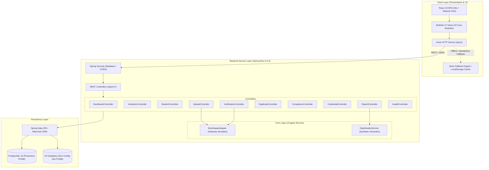
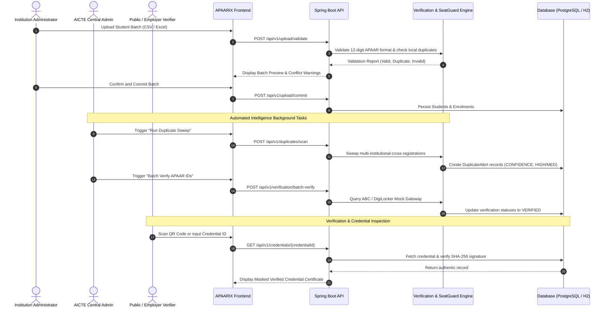

<div align="center">


# APAARIX

### APAAR-Based Student Verification & Enrolment Intelligence Platform

**One Student. One Trusted Identity. Smarter Enrolment Intelligence.**

[](https://spring.io/projects/spring-boot)
[](https://www.oracle.com/java/)
[](https://react.dev/)
[](https://vitejs.dev/)
[](https://tailwindcss.com/)
[](https://www.postgresql.org/)
[](https://www.docker.com/)

<p align="center">
  <a href="https://github.com/VisionVibes2026/APAARIX">GitHub Repository</a> •
  <a href="#-project-overview">Project Overview</a> •
  <a href="#-key-features">Key Features</a> •
  <a href="#-system-architecture">Architecture</a> •
  <a href="#-installation-and-setup">Quick Start</a> •
  <a href="#-api-documentation">API Reference</a>
</p>

</div>

---

## 📋 Table of Contents

- [Project Overview](#-project-overview)
- [Key Features](#-key-features)
- [Application Screenshots & UI Modules](#-application-screenshots--ui-modules)
- [System Architecture](#-system-architecture)
- [Technology Stack](#-technology-stack)
- [Application Workflow](#-application-workflow)
- [Project Structure](#-project-structure)
- [Installation and Setup](#-installation-and-setup)
- [Environment Variables](#-environment-variables)
- [API Documentation](#-api-documentation)
- [Demo Accounts & Access](#-demo-accounts--access)
- [Security and Privacy](#-security-and-privacy)
- [APAAR Integration Note](#-apaar-integration-note)
- [Project Roadmap](#-project-roadmap)
- [Contribution Guidelines](#-contribution-guidelines)
- [License](#-license)
- [Contact and Acknowledgements](#-contact-and-acknowledgements)

---

## 🌐 Project Overview

**APAARIX** is a full-stack, enterprise-grade student verification and enrolment intelligence platform designed for the **All India Council for Technical Education (AICTE)** and its approved institutions across India. 

The platform leverages the **Automated Permanent Academic Account Registry (APAAR ID)** — the unique 12-digit lifelong academic identifier established under the National Education Policy (NEP 2020) — to establish centralized student identity verification, eliminate ghost enrolments, prevent multi-institution admission fraud, and enforce statutory intake quotas.

### Core Challenges Addressed

1. **Fragmented Institutional Registries:** Institutions maintain isolated enrolment silos, creating blind spots for regulatory oversight.
2. **Duplicate & Multi-Institution Enrolments:** Students holding simultaneous seats in multiple colleges across states, causing artificial seat blocking.
3. **Approved Intake Violations:** Colleges exceeding sanctioned capacity in high-demand programmes (such as CSE or IT) or violating supernumerary quota ceilings (NRI, PIO, Lateral Entry).
4. **Manual Credential Verification:** Employers, universities, and regulatory authorities face weeks of bureaucratic delay to verify degree and enrolment legitimacy.
5. **Data Privacy & Identifier Exposure:** Uncontrolled dissemination of complete academic and national identity numbers during routine audits.

### Target Stakeholders

| Stakeholder | Role in APAARIX |
|---|---|
| **AICTE Central Regulatory Ops** | Nationwide oversight, duplicate detection sweeps, quota compliance monitoring, and statistical reporting. |
| **Institution Administrators** | Student batch uploading, approved intake tracking, roster management, and statutory notice resolution. |
| **Students** | Self-service credential wallet, verification tracking, consent log management, and digital identity access. |
| **Third-Party Verifiers** | Instant, zero-friction cryptographic verification of student enrolment without exposing raw personally identifiable information (PII). |

---

## ⚡ Key Features

### 1. Centralized Student Registry
- Unified directory capturing student profiles, institutional affiliations, degree programmes, admission categories, and enrolment timelines.
- Real-time global search with debounced filtering across student IDs, names, masked APAAR IDs, and institutions.
- Multi-column sorting, pagination, and slide-over student detail inspection drawers.

### 2. Institutional Registry & Intake Management
- Profile repository for technical universities, colleges, and autonomous institutions.
- Tracks approved intake quotas across undergraduate and postgraduate programmes.
- Institutional compliance scoring (0–100%) and seat utilization metrics updated dynamically.

### 3. Student Batch Data Ingestion Engine
- Supports standardized CSV and Excel batch docket uploads.
- Automated client-side and server-side validation against schema constraints, mandatory fields, and formatting rules.
- Pre-commit duplicate detection cross-checking incoming records against active institutional databases.
- Instant error reporting with downloadable issue summaries.

### 4. APAAR Identity Verification Engine
- Validates 12-digit APAAR numbers with normalization and checksum validation (`XXXX-XXXX-XXXX`).
- Single-student and batch verification queues simulating Academic Bank of Credits (ABC) validation.
- Status classification: `VERIFIED`, `PENDING`, `INVALID`, `MANUAL_REVIEW`, and `API_UNAVAILABLE`.
- Administrator override interface with mandatory audit justification notes.

### 5. Cross-Institution Duplicate Detection
- Automated registry sweep algorithm identifying identical APAAR identifiers registered across conflicting institutions.
- Secondary multi-factor matching evaluating name and date-of-birth demographic similarities.
- Dual-institution side-by-side comparison cards displaying match reasons and confidence levels (`HIGH`, `MEDIUM`, `LOW`).
- Review resolution workflow: confirm duplicate, mark genuine, or escalate for manual investigation.

### 6. SeatGuard Statutory Admission Compliance
- Real-time surveillance comparing actual admissions against sanctioned intake limits.
- Category-specific monitoring for general intake, supernumerary quotas (NRI, OCI, Lateral Entry).
- Automatic violation generation categorized by severity (`CRITICAL`, `HIGH`, `MEDIUM`, `LOW`).
- Formal notice resolution tracking and penalty audit trails.

### 7. AICTE Executive Command Dashboard
- High-level KPI indicators: Total Approved Institutions, Total Active Enrolments, Verified APAAR Records, and Open Compliance Alerts.
- Interactive visualizations: APAAR status breakdowns (donut chart), top institutions by enrolment capacity, and multi-year admission trends.
- Quick action triggers: automated duplicate sweep, batch gateway verification, and docket upload shortcuts.

### 8. Student Self-Service Portal
- Student login access with authenticated identity and academic standing.
- APAAR link confirmation and verification timeline.
- Enrolment history across previous and active academic programmes.
- Digital consent management log tracking third-party access requests.

### 9. Tamper-Proof Digital Credentials & QR Verification
- Cryptographic digital credential issuance with unique identifiers (`CRD-2024-XXXX`).
- SHA-256 signature hashes binding student ID, APAAR ID, and institution code.
- Verifiable QR codes linking to public verification endpoints.
- Privacy-preserving public verifier view displaying masked identifiers to prevent identity theft.

### 10. Regulatory Reports & Audit Exports
- One-click CSV and structured exports for student registries and compliance violations.
- Institutional summary reports covering seat utilization percentages and statutory adherence.
- Real-time system diagnostic endpoints reporting database health, memory utilization, and JVM status.

### 11. Role-Based Access Control (RBAC) & Interactive Gateway
- Dedicated UI perspectives tailored to four distinct personas: **AICTE National Admin**, **Institution Admin**, **Student**, and **Third-Party Verifier**.
- Instant quick-access switchers and single-click demo login buttons.

### 12. Synthetic Demo State Engine
- Integrated reset action re-seeding realistic synthetic datasets (10 premier technical institutions, 90+ students, deliberate duplicate cases, and quota violations).
- Dual-mode architecture: seamlessly connects to Spring Boot backend or operates standalone via client-side storage fallback when deployed without backend infrastructure.

---

## 🖼️ Application Screenshots & UI Modules

The APAARIX platform includes 10 fully functional UI views styled with enterprise design principles:

| Module | Interface Description | Status |
|---|---|---|
| **Login & Role Gateway** | Split-screen enterprise entrance featuring brand visuals, quick-login role buttons, and integrated evaluator walkthrough. | Available |
| **Executive Command Dashboard** | Real-time analytics command center with KPI summary cards, Recharts visualizations, and system control actions. | Available |
| **Institution Portal** | Searchable registry of approved technical institutions with programme intake quotas and compliance scores. | Available |
| **National Student Registry** | Comprehensive student data table featuring global debounced search, status badges, and detail inspection drawers. | Available |
| **Batch Ingestion Engine** | File upload workflow with format parsing, template downloads, schema checks, and pre-commit preview tables. | Available |
| **APAAR Verification Engine** | Identity verification interface with gateway summary metrics, batch verifiers, and manual override dialogs. | Available |
| **Duplicate Detection** | Side-by-side comparative cards highlighting conflicting institutional enrolments and resolution workflows. | Available |
| **SeatGuard Compliance** | Statutory monitoring dashboard tracking approved capacity vs actual intake with violation flags. | Available |
| **Student Self-Service Portal** | Individual learner portal displaying linked APAAR status, academic history, and consent records. | Available |
| **Digital Credential Verifier** | QR code credential inspection page providing masked public verification of enrolment authenticity. | Available |
| **Reports & Export Center** | Download hub for official AICTE student registries, compliance audits, and regulatory data sheets. | Available |

> *To update screenshots, place your PNG or JPEG captures into the `frontend/public/` directory and reference them using Markdown image syntax.*

---

## 🏗️ System Architecture

APAARIX implements a decoupled, modern multi-tier architecture adhering to enterprise software engineering standards:



---

## 🛠️ Technology Stack

### Frontend
- **Framework:** [React 18.3.1](https://react.dev/)
- **Build Tool:** [Vite 5.4.10](https://vitejs.dev/)
- **Styling:** [Tailwind CSS 3.4.14](https://tailwindcss.com/) with PostCSS & Autoprefixer
- **UI Icons:** [Lucide React 0.454.0](https://lucide.dev/)
- **Charts & Data Visualization:** [Recharts 2.13.0](https://recharts.org/)
- **HTTP Client:** [Axios 1.7.7](https://axios-http.com/)
- **Animations:** [Framer Motion 11.11.11](https://www.framer.com/motion/)
- **Client Routing:** [React Router DOM 6.27.0](https://reactrouter.com/)

### Backend
- **Runtime:** [Java 21 LTS](https://www.oracle.com/java/) (Compatible with Java 21–24)
- **Framework:** [Spring Boot 3.3.5](https://spring.io/projects/spring-boot)
  - `spring-boot-starter-web` (RESTful APIs)
  - `spring-boot-starter-data-jpa` (Persistence & ORM)
  - `spring-boot-starter-security` (Stateless Authorization & CORS)
  - `spring-boot-starter-validation` (Bean Validation & Constraints)
- **Security & Tokens:** `jjwt 0.12.6` (JSON Web Token infrastructure)
- **Build System:** Apache Maven 3.9+

### Database & Infrastructure
- **Production Database:** [PostgreSQL 16](https://www.postgresql.org/)
- **Development Database:** Embedded [H2 Database](https://www.h2database.com/) (PostgreSQL dialect mode, zero installation needed)
- **Containerization:** Docker & Docker Compose (`postgres:16-alpine` + `pgadmin4:latest`)
- **Deployment Support:** Vercel SPA rewrites (`vercel.json`), Netlify redirects (`_redirects`)

---

## 🔄 Application Workflow

The diagram below illustrates how student data moves through the APAARIX platform from initial institution ingestion to public credential verification:



---

## 📁 Project Structure

```
AicteProjectFile/
├── docker-compose.yml                      # PostgreSQL 16 & pgAdmin 4 local container stack
├── README.md                               # Project technical documentation
├── .gitignore                              # Git exclusion rules for Java, Node, and binaries
│
├── backend/                                # Spring Boot 3.3.5 REST API application
│   ├── pom.xml                             # Maven build configuration & dependencies
│   └── src/
│       ├── main/
│       │   ├── java/com/apaarix/
│       │   │   ├── ApaarixApplication.java # Spring Boot main entrypoint
│       │   │   ├── config/
│       │   │   │   └── CorsConfig.java     # Global CORS origin filtering
│       │   │   ├── controller/             # REST API endpoint controllers
│       │   │   │   ├── ComplianceController.java   # SeatGuard intake quota enforcement
│       │   │   │   ├── CredentialController.java   # Digital credentials & student profile
│       │   │   │   ├── DashboardController.java    # Executive metrics & charts
│       │   │   │   ├── DuplicateController.java    # Cross-institution duplicate alerts
│       │   │   │   ├── HealthController.java       # System diagnostics & health check
│       │   │   │   ├── InstitutionController.java  # Institutional directory & programmes
│       │   │   │   ├── ReportController.java       # CSV exports & summary generation
│       │   │   │   ├── StudentController.java      # Student registry CRUD & search
│       │   │   │   ├── UploadController.java       # CSV batch processing & templates
│       │   │   │   └── VerificationController.java # APAAR gateway identity checks
│       │   │   ├── dto/
│       │   │   │   ├── ApiResponse.java        # Standardized JSON response envelope
│       │   │   │   └── SystemInfoResponse.java # System diagnostic DTO
│       │   │   ├── entity/                     # JPA Hibernate database entities
│       │   │   │   ├── ApaarVerification.java
│       │   │   │   ├── ComplianceViolation.java
│       │   │   │   ├── DigitalCredential.java
│       │   │   │   ├── DuplicateAlert.java
│       │   │   │   ├── Enrolment.java
│       │   │   │   ├── Institution.java
│       │   │   │   ├── Programme.java
│       │   │   │   └── Student.java
│       │   │   ├── enums/                      # Domain enumerations (Status, Quota, Category)
│       │   │   ├── exception/
│       │   │   │   └── GlobalExceptionHandler.java # Centralized HTTP exception handler
│       │   │   ├── integration/
│       │   │   │   └── MockApaarAdapter.java   # Deterministic APAAR gateway simulator
│       │   │   ├── repository/                 # Spring Data JPA database repositories
│       │   │   ├── security/
│       │   │   │   └── SecurityConfig.java     # Stateless security filter chain
│       │   │   ├── service/
│       │   │   │   └── DataSeederService.java  # Realistic synthetic database generator
│       │   │   └── util/
│       │   │       └── DateTimeUtils.java      # Date/time formatters
│       │   └── resources/
│       │       ├── application.properties      # Default configuration (H2 in PostgreSQL mode)
│       │       ├── application-postgres.properties # Dedicated PostgreSQL profile
│       │       └── init-db.sql                 # PostgreSQL initialization script
│       └── test/                               # JUnit & Spring Security test suites
│
└── frontend/                               # React 18+ Vite Single Page Application
    ├── package.json                        # Dependencies, scripts, and build metadata
    ├── vite.config.js                      # Bundler config, dev server, and /api proxy
    ├── tailwind.config.js                  # Color palettes, typography, and card tokens
    ├── postcss.config.js                   # CSS transformation pipeline
    ├── index.html                          # Web shell with Outfit and Inter font links
    ├── vercel.json                         # Vercel SPA routing rewrite rules
    ├── public/
    │   ├── apaarix-logo.jpg                # Official project branding logo
    │   └── _redirects                      # Netlify SPA routing rewrite rule
    └── src/
        ├── index.css                       # Tailwind layers and custom styling
        ├── main.jsx                        # React 18 createRoot mount
        ├── App.jsx                         # Main app router, role state, and theme logic
        ├── components/
        │   ├── auth/
        │   │   └── Login.jsx               # Login page with evaluator quick-switch cards
        │   ├── layout/
        │   │   ├── Header.jsx              # Top header with role switcher, theme toggle
        │   │   └── Sidebar.jsx             # Collapsible left navigation with badges
        │   └── modules/                    # Feature views (10 core modules)
        │       ├── ApaarVerificationView.jsx
        │       ├── DashboardView.jsx
        │       ├── DigitalCredentialsView.jsx
        │       ├── DuplicateDetectionView.jsx
        │       ├── InstitutionPortalView.jsx
        │       ├── ReportsAnalyticsView.jsx
        │       ├── SeatGuardComplianceView.jsx
        │       ├── StudentPortalView.jsx
        │       ├── StudentRegistryView.jsx
        │       └── StudentUploadView.jsx
        └── services/
            ├── api.js                      # Axios client with offline fallback interceptors
            └── mockData.js                 # Standalone synthetic database store
```

---

## 🚀 Installation and Setup

### 1. Prerequisites
- **Java Development Kit (JDK):** Version 21 or higher installed (`java -version`)
- **Apache Maven:** Version 3.9 or higher (`mvn -version`)
- **Node.js:** Version 18 or higher with npm (`node -v` and `npm -v`)
- **Git:** Installed on your path
- *(Optional)* **Docker & Docker Compose:** Required only if running local PostgreSQL containers

---

### 2. Clone the Repository

```bash
git clone https://github.com/VisionVibes2026/APAARIX.git
cd APAARIX
```

---

### 3. Backend Setup & Startup

The backend is configured to run out-of-the-box with **zero external database setup** using an in-memory database operating in PostgreSQL-compatible mode.

#### Mode A: Zero-Config In-Memory Mode (Instant Setup)

```bash
cd backend
mvn clean package -DskipTests
java -jar target/apaarix-backend-1.0.0-SNAPSHOT.jar
```
Or run directly through the Spring Boot Maven plugin:
```bash
cd backend
mvn spring-boot:run
```

The Spring Boot backend will start on **`http://localhost:8080`**.  
The database is automatically seeded with 10 institutions, 90 students, programmes, duplicate alerts, and quota violations upon first start.

#### Mode B: Dedicated PostgreSQL Container Mode

1. Start PostgreSQL 16 and pgAdmin 4 using Docker Compose from the project root:
   ```bash
   docker compose up -d
   ```
2. Start the backend with the PostgreSQL profile activated:
   ```bash
   cd backend
   mvn spring-boot:run -Dspring-boot.run.profiles=postgres
   ```
   *pgAdmin 4 will be available at `http://localhost:5050` (Username: `admin@apaarix.aicte.gov.in`, Password: `admin`).*

---

### 4. Frontend Setup & Startup

1. Open a new terminal in the `frontend` directory:
   ```bash
   cd frontend
   npm install
   ```
2. Start the Vite development server:
   ```bash
   npm run dev
   ```
3. Open your browser and navigate to:
   ```
   http://localhost:5173
   ```
   *(If port 5173 is occupied, Vite will automatically select the next available port, e.g., `http://localhost:5174`)*

---

### 5. Frontend Production Build

To build the optimized static production bundle:
```bash
cd frontend
npm run build
```
The compiled assets will be output to `frontend/dist/`. You can preview the production build locally with:
```bash
npm run preview
```

---

## 🔐 Environment Variables

### Backend Configuration (`backend/src/main/resources/application.properties`)

| Variable | Default Value | Description |
|---|---|---|
| `PORT` | `8080` | Port on which the Spring Boot server listens. |
| `DB_URL` | `jdbc:h2:mem:apaarix_dev;MODE=PostgreSQL...` | Database connection JDBC URL. |
| `DB_USERNAME` | `sa` (or `postgres` in postgres profile) | Database username. |
| `DB_PASSWORD` | *(empty in dev)* | Database password. |
| `CORS_ALLOWED_ORIGINS` | `http://localhost:5173,http://localhost:3000` | Comma-delimited list of permitted CORS origins. |
| `JWT_SECRET` | `404E635266556A586E3272357538782F...` | 256-bit cryptographic secret for signing JWTs. |
| `JWT_EXPIRATION_MS` | `86400000` (24 Hours) | Lifespan of generated tokens in milliseconds. |

### Frontend Configuration (`frontend/.env`)

| Variable | Default Value | Description |
|---|---|---|
| `VITE_API_BASE_URL` | `http://localhost:8080/api/v1` | URL pointing to the Spring Boot REST API. |
| `VITE_APP_NAME` | `APAARIX AICTE Platform` | Application title display. |
| `VITE_APP_VERSION` | `1.0.0-PROTOTYPE` | Active application build version. |

*Note: In production deployments where no backend URL is supplied, the frontend automatically falls back to its internal resilient client-side mock store.*

---

## 📡 API Documentation

All REST API endpoints are prefixed with `/api/v1` and return responses in a standardized JSON envelope:

```json
{
  "success": true,
  "message": "Operation description",
  "data": { ... },
  "timestamp": "2026-11-02T10:00:00Z"
}
```

### Endpoints Reference Table

| Category | HTTP Method | Endpoint | Description |
|---|---|---|---|
| **System** | `GET` | `/api/v1/health` | Returns service health, version, and database connectivity. |
| **System** | `GET` | `/api/v1/system/info` | Diagnostic JVM memory statistics, active profile, and DB details. |
| **Dashboard** | `GET` | `/api/v1/dashboard/metrics` | High-level metrics, verification percentages, and trend series. |
| **Institutions** | `GET` | `/api/v1/institutions` | Searchable list of institutions (supports `?search=` and `?state=`). |
| **Institutions** | `GET` | `/api/v1/institutions/{id}` | Detailed institution profile with programme quotas and violations. |
| **Institutions** | `POST` | `/api/v1/institutions` | Registers a new technical institution. |
| **Students** | `GET` | `/api/v1/students` | Paginated registry with filters (`?search=`, `?verificationStatus=`, etc.). |
| **Students** | `POST` | `/api/v1/students` | Enrols a single student into the national registry. |
| **Ingestion** | `GET` | `/api/v1/upload/template` | Downloads the standardized CSV ingestion template file. |
| **Ingestion** | `POST` | `/api/v1/upload/validate` | Validates a batch payload without persisting records. |
| **Ingestion** | `POST` | `/api/v1/upload/commit` | Persists validated student batch records to the database. |
| **Verification** | `GET` | `/api/v1/verification/summary` | Verification counts breakdown across status categories. |
| **Verification** | `POST` | `/api/v1/verification/verify-student/{id}` | Triggers APAAR gateway verification probe for a student. |
| **Verification** | `POST` | `/api/v1/verification/batch-verify` | Simulates batch gateway verification for all pending records. |
| **Verification** | `POST` | `/api/v1/verification/override/{id}` | Applies administrative override to a student's verification status. |
| **Duplicates** | `GET` | `/api/v1/duplicates` | Lists flagged cross-institution duplicate alerts (`?status=`). |
| **Duplicates** | `POST` | `/api/v1/duplicates/{id}/resolve` | Records regulatory decision on duplicate cases (`CONFIRMED`/`GENUINE`). |
| **Duplicates** | `POST` | `/api/v1/duplicates/scan` | Executes full-registry sweep for multi-institution enrolments. |
| **SeatGuard** | `GET` | `/api/v1/compliance/summary` | Overview of approved intake vs actual admissions and scores. |
| **SeatGuard** | `GET` | `/api/v1/compliance/violations` | Lists open and resolved statutory seat exceedance notices. |
| **SeatGuard** | `POST` | `/api/v1/compliance/violations/{id}/resolve` | Records formal compliance resolution and notes. |
| **SeatGuard** | `GET` | `/api/v1/compliance/institution/{id}` | Detailed programme-level seat utilization analysis. |
| **Credentials** | `GET` | `/api/v1/credentials/{credentialId}` | Public masked credential validation endpoint. |
| **Credentials** | `GET` | `/api/v1/credentials/student/{studentId}` | Retrieves issued digital credential for a specific student. |
| **Credentials** | `POST` | `/api/v1/credentials/generate/{studentId}` | Issues new verifiable digital credential with cryptographic hash. |
| **Student Portal**| `GET` | `/api/v1/student-portal/profile/{studentId}`| Student self-service profile, enrolment records, and consent log. |
| **Reports** | `GET` | `/api/v1/reports/summary` | Aggregate regulatory report summary across all technical campuses. |
| **Reports** | `GET` | `/api/v1/reports/export/students` | Downloads full nationwide student enrolment records as CSV. |
| **Reports** | `GET` | `/api/v1/reports/export/compliance` | Downloads compliance audit violation logs as CSV. |
| **Demo Utility** | `POST` | `/api/v1/reports/reset-demo` | Resets all database tables and re-seeds synthetic prototype data. |

---

## 👥 Demo Accounts & Access

The login interface provides **one-click instant login buttons** for evaluators to test all four distinct platform roles:

| Username | Password | Role Description | Permissions & Features |
|---|---|---|---|
| `admin` | `admin123` | **AICTE National Admin** | Full nationwide command access, duplicate scans, batch verifications, compliance reviews, and data reset. |
| `institution` | `inst123` | **Institution Admin (DTU)** | Campus-level portal, student upload engine, seat utilization monitoring, and student enrolment records. |
| `student` | `stud123` | **Student (Aarav Sharma)** | Personal learner portal, linked APAAR status timeline, digital credential QR card, and consent logs. |
| `verifier` | `veri123` | **Third-Party Verifier** | Public credential validation interface with cryptographic signature checks and masked identity confirmation. |

---

## 🔒 Security and Privacy

1. **Stateless REST Security:** Backend routes are safeguarded via Spring Security 6 with token parsing infrastructure (`jjwt`).
2. **Privacy-Preserving Public Views:** When credentials or student records are queried through public verification routes, sensitive identifiers are masked (e.g., `7821-XXXX-9012`), shielding raw APAAR IDs from web scraping.
3. **Cryptographic Signature Tokens:** Digital credentials compute a deterministic SHA-256 signature hash combining the unique credential token, normalized APAAR ID, student code, and institutional issuance timestamp.
4. **Audit Justification Logs:** Administrative overrides on verification statuses and duplicate dismissals require explicit textual audit logs stored alongside the timestamp.
5. **CORS Hardening:** Configured with specific origin headers to restrict cross-site execution to recognized institutional and client domains.

---

## ℹ️ APAAR Integration Note

> **Important Disclosure on Gateway Simulation:**  
> The APAARIX prototype incorporates a dedicated integration adapter (`MockApaarAdapter`) that faithfully simulates the validation protocols of the **Academic Bank of Credits (ABC)** and **DigiLocker** identity gateways.
>
> To facilitate realistic testing and demonstration of edge cases:
> - Any APAAR ID starting with **`9999`** triggers an `INVALID` response (simulating an unregistered identifier).
> - Any APAAR ID starting with **`8888`** triggers a `MANUAL_REVIEW` response (simulating a demographic name mismatch).
> - Any APAAR ID starting with **`0000`** triggers an `API_UNAVAILABLE` response (simulating a gateway timeout).
> - All other properly formatted 12-digit numbers return a `VERIFIED` status with high confidence (0.98).
>
> *This prototype does not claim live production access to official Government of India production APIs; it provides an architectural adapter ready to connect to production REST/SOAP gateway endpoints once formal institutional API credentials are provisioned.*

---

## 🗺️ Project Roadmap

### ✅ Completed
- [x] Full-stack architecture with decoupled React 18 frontend and Spring Boot 3 backend.
- [x] Centralized Student Registry with debounced search, filtering, and pagination.
- [x] Institutional Registry managing sanctioned intake, programme allocations, and compliance scores.
- [x] CSV Batch Ingestion Engine with client-side parsing and pre-commit conflict detection.
- [x] APAAR Identity Verification Engine with deterministic simulation adapter.
- [x] Cross-Institution Duplicate Detection with confidence scoring and side-by-side reviews.
- [x] SeatGuard Statutory Compliance Engine monitoring admission overflow and supernumerary caps.
- [x] Student Self-Service Portal with linked identity tracking and consent history.
- [x] Verifiable Digital Credentials with QR code verification and cryptographic signature hashes.
- [x] Dual-mode resilience: seamless transition between live backend API and standalone client-side mock store.
- [x] One-click demo evaluator walkthrough and multi-role gateway.

### 🟡 In Progress
- [ ] Automated OCR parsing for physical mark sheets and admission slips during file upload.
- [ ] Granular permission matrix allowing institutional sub-roles (Dean, Registrar, Department Head).
- [ ] Automated email and webhook notifications for high-severity statutory intake violations.

### 🔮 Planned
- [ ] Production OAuth 2.0 integration with DigiLocker and National Academic Depository (NAD).
- [ ] Blockchain-backed verifiable credential anchoring for decentralized credential proofs.
- [ ] Machine learning anomaly detection model analyzing historical multi-year admission patterns.

---

## 🤝 Contribution Guidelines

Contributions to the APAARIX platform are welcome. Follow these steps to submit changes:

1. **Fork the Repository:** Click the `Fork` button at the top right of this repository.
2. **Clone your fork:**
   ```bash
   git clone https://github.com/<your-username>/APAARIX.git
   cd APAARIX
   ```
3. **Create a Feature Branch:**
   ```bash
   git checkout -b feature/your-feature-name
   ```
4. **Implement your changes** adhering to the existing code conventions (Spring Boot REST standards, React component modularity, and Tailwind styling).
5. **Verify builds locally:**
   ```bash
   # Backend check
   cd backend && mvn clean test
   
   # Frontend check
   cd ../frontend && npm run build
   ```
6. **Commit with descriptive messages:**
   ```bash
   git commit -m "feat: Add descriptive summary of your implementation"
   ```
7. **Push to your branch:**
   ```bash
   git push origin feature/your-feature-name
   ```
8. **Open a Pull Request:** Navigate to the original repository and submit your PR with a description of your modifications.

---

## 📄 License

This project currently has no specified open-source license. All rights are reserved by the project authors and maintaining organization. For inquiries regarding licensing, distribution, or commercial deployment, please contact the repository owners.

---

## 📬 Contact and Acknowledgements

- **Repository:** [VisionVibes2026/APAARIX](https://github.com/VisionVibes2026/APAARIX)
- **Developed for:** All India Council for Technical Education (AICTE) technical education ecosystem.
- **Architectural Reference:** National Education Policy (NEP 2020) • Academic Bank of Credits (ABC) • Automated Permanent Academic Account Registry (APAAR).

<div align="center">
  <sub>Built with precision for transparent, verified, and intelligent technical education management.</sub>
</div>
